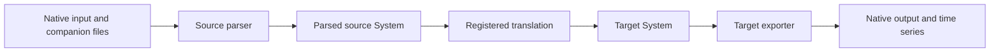

R2X maintains four translation packages. Each registers one function in the
`r2x.transforms` entry-point group. Install the package for your direction,
then combine it with the source parser and target exporter. The translation
functions consume an in-memory `r2x_core.System`; they do not open a native
model file or write an export by themselves.

| Package | Registered transform | Input → output | Workflow |
| --- | --- | --- | --- |
| [`r2x-reeds-to-plexos`](https://pypi.org/project/r2x-reeds-to-plexos/) | `reeds-to-plexos` | ReEDS → PLEXOS | [Run the workflow](/R2X/how-to/reeds-to-plexos/) |
| [`r2x-reeds-to-sienna`](https://pypi.org/project/r2x-reeds-to-sienna/) | `reeds-to-sienna` | ReEDS → Sienna | [Run the workflow](/R2X/how-to/reeds-to-sienna/) |
| [`r2x-plexos-to-sienna`](https://pypi.org/project/r2x-plexos-to-sienna/) | `plexos-to-sienna` | PLEXOS → Sienna | [Run the workflow](/R2X/how-to/plexos-to-sienna/) |
| [`r2x-sienna-to-plexos`](https://pypi.org/project/r2x-sienna-to-plexos/) | `sienna-to-plexos` | Sienna → PLEXOS | [Run the workflow](/R2X/how-to/sienna-to-plexos/) |

These registrations come from the four workspace `pyproject.toml` files.
There are no `r2x.sysmods` registrations in these translation packages.
Source-specific system modifiers, such as preprocessing ReEDS generation,
belong to the source package; see the
[r2x-reeds system modifiers](https://natlabrockies.github.io/r2x-reeds/getting-started/system-modifiers/).
A proposed translation is not available merely because a feature branch exists.

## Choose a pipeline



Start with the source format you already have. For ReEDS input, choose
`r2x-reeds-to-plexos` or `r2x-reeds-to-sienna`; for PLEXOS input, choose
`r2x-plexos-to-sienna`; for Sienna input, choose `r2x-sienna-to-plexos`.
Each package ships its own rules and typed configuration. Review the property
mappings before interpreting the translated model: a successful export does not
establish equivalence between the optimization formulations.

The [API reference](/R2X/reference/python-api/) describes return values and
configuration defaults. The [architecture](/R2X/explanation/architecture/) explains
why parsing and export remain separate. For a first exercise without a ReEDS
run or licensed PLEXOS installation, complete the
[Sienna CLI tutorial](/R2X/tutorials/getting-started/).

## Inspect installed registrations

After [installation](/R2X/getting-started/installation/), verify the registration
in the same environment that will run your pipeline:

```bash
r2x list r2x-reeds-to-sienna
```

Expect `reeds-to-sienna`. If it is absent, check the selected CLI runtime and
installed package version using [Troubleshooting](/R2X/troubleshooting/).
Python users can inspect the installed entry-point metadata directly:

```pycon
>>> from importlib.metadata import distribution
>>> package = distribution("r2x-reeds-to-sienna")
>>> transforms = {entry.name: entry.value for entry in package.entry_points if entry.group == "r2x.transforms"}
>>> assert transforms["reeds-to-sienna"] == "r2x_reeds_to_sienna.translation:reeds_to_sienna"
```
