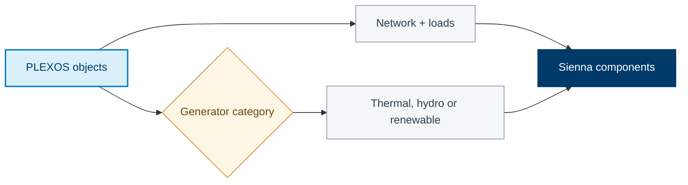

Parse the source model, translate its components, and export the target model.

[Translation source](https://github.com/NatLabRockies/R2X/blob/main/packages/r2x-plexos-to-sienna/src/r2x_plexos_to_sienna/translation.py) · [Configuration](https://github.com/NatLabRockies/R2X/blob/main/packages/r2x-plexos-to-sienna/src/r2x_plexos_to_sienna/plugin_config.py)

## Mapping Overview

The translation keeps the PLEXOS object class where it is meaningful, and uses
the generator `category` to choose the Sienna generator family. The diagram summarizes the mapping groups in the rule set linked below.



### Generator Category Families

The exact slug mappings are defined in `r2x_plexos_to_sienna.mappings`.
Descriptive categories such as `Wind SA`, `Black Coal QLD`, and `Hydro TAS`
use ordered keyword matching; the first matching keyword determines the Sienna
family. For example, `gas-cc` and `gas-ct` become `ThermalStandard`, while
`thermal-multi-start` becomes `ThermalMultiStart`.

For field-by-field mappings, see [PLEXOS to Sienna property mappings](/R2X/reference/plexos-to-sienna-properties/).

## Setup

Use Python 3.11–3.13 and uv. From this repository checkout, replace the
editable package paths below with your local parser and exporter checkouts.
These commands update the workspace environment and lockfile:

First, install the dependencies pinned by this checkout:

```bash
uv sync
```

Add your source parser checkout so the script can read the native input model:

```bash
uv add --editable /path/to/r2x-plexos
```

Add the target parser/exporter checkout, then verify that the command completes
before running the Python example:

```bash
uv add --editable /path/to/r2x-sienna
```

## Example script

Replace the model paths and years with your input data. A successful run writes
the target model and time-series files to the configured results directory.
`run()` executes the plugin lifecycle and raises an error if a hook fails.

```python
from pathlib import Path

from plexosdb import PlexosDB
from plexosdb.enums import ClassEnum
from r2x_plexos import PLEXOSConfig, PLEXOSParser
from r2x_plexos_to_sienna.plugin_config import PlexosToSiennaConfig
from r2x_plexos_to_sienna.translation import plexos_to_sienna
from r2x_sienna.exporter import SiennaExporter
from r2x_sienna.plugin_config import SiennaConfig

from r2x_core import DataFile, DataStore, PluginContext
from r2x_core.logger import setup_logging

setup_logging(verbosity=2)

case_name = "20241018_2023system_EI_ba"
folder_path = Path(f"/path/to/{case_name}")
model_year = 2012

# PLEXOS PARSER
xml_path = folder_path / "20241018_2023system_EI_ba.xml"
db = PlexosDB.from_xml(xml_path)
# Examining first the models in the plexos run would be helpful when trying
# to translate from PLEXOS to Sienna
model_names = db.list_objects_by_class(ClassEnum.Model)
model_name = model_names[0] if model_names else "Base"

plexos_config = PLEXOSConfig(
    model_name=model_name,
    horizon_year=model_year,
    models=("r2x_plexos.models", "r2x_sienna.models"),
)
data_file = DataFile(name="xml_file", fpath=xml_path)
store = DataStore(path=folder_path)
store.add_data([data_file])

context = PluginContext(config=plexos_config, store=store)
parser = PLEXOSParser.from_context(context)
plexos_sys_result = parser.run()
plexos_sys = plexos_sys_result.system

sienna_sys = plexos_to_sienna(plexos_sys, PlexosToSiennaConfig())

# Sienna Exporter
results_dir = folder_path / "results"
results_dir.mkdir(exist_ok=True)
output_file = str(results_dir / f"{case_name}.json")
sienna_config = SiennaConfig(system_name=case_name, model_year=model_year, output_path=output_file)

exporter_context = PluginContext(
    config=sienna_config,
    system=sienna_sys,
)
exporter = SiennaExporter.from_context(exporter_context)

exporter.run()
```
