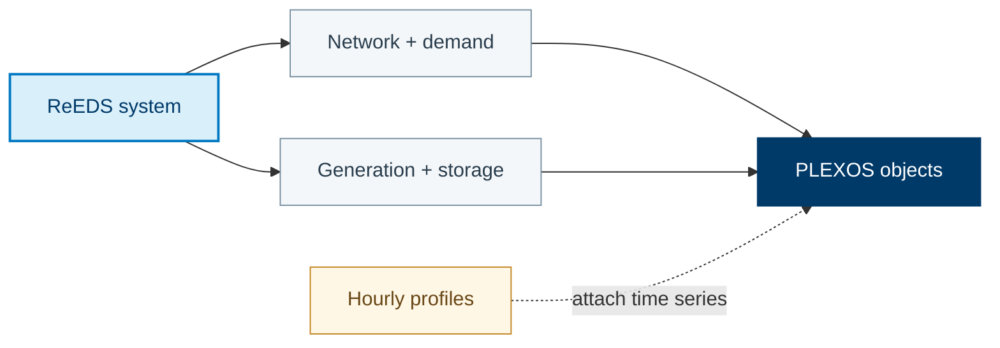

See the [ReEDS translation comparison](/R2X/reference/reeds-translation-reference/)
for side-by-side component mappings, time-series treatment, and modeling limitations.

Parse the source model, translate its components, and export the target model.

[Translation source](https://github.com/NatLabRockies/R2X/blob/main/packages/r2x-reeds-to-plexos/src/r2x_reeds_to_plexos/translation.py) · [Configuration](https://github.com/NatLabRockies/R2X/blob/main/packages/r2x-reeds-to-plexos/src/r2x_reeds_to_plexos/plugin_config.py)

## Mapping Overview

PLEXOS uses a smaller set of broad classes than ReEDS. In particular, several
ReEDS generator families become `PLEXOSGenerator`; the technology details are
carried by fields such as `category` and by memberships. ReEDS consuming
technologies become either generators or purchasers according to their role.



### Generator and Demand Collapsing

`PLEXOSGenerator` is the common PLEXOS representation for thermal, variable,
hydro, generic, consuming-technology, and some storage-generator outputs.
Hydrogen production and data-center demand are represented as
`PLEXOSPurchaser`, while storage can produce `PLEXOSBattery` and
`PLEXOSStorage` components.

### Topology and Memberships

Regions become the PLEXOS region, zone, and node objects needed by the target
model. The translation helpers then create memberships connecting generators,
batteries, purchasers, lines, and regions to their PLEXOS topology.

For field-by-field mappings, see [ReEDS to PLEXOS property mappings](/R2X/reference/reeds-to-plexos-properties/).

## Setup

Complete [installation](/R2X/getting-started/installation/) in a Python 3.11–3.13
virtual environment, then install the published translator and its parser/exporter
dependencies:

```bash
python -m pip install r2x-reeds-to-plexos
python -m pip check
```

Use compatible versions of the source and target packages. You do not need to
modify this repository's lockfile or add editable checkouts to run a translation.
For a runnable exercise without external model data, start with the
[Python translation tutorial](/R2X/tutorials/python-translation/).

<span id="example-script"></span>

## Run the translation

Start a fresh Python console for this workflow. Replace the model paths and years
with your input data before entering the session below. A successful run writes
the target model and time-series files to the configured results directory.
`run()` executes the plugin lifecycle and raises an error if a hook fails.

```pycon
>>> import os
>>> from pathlib import Path
>>> from typing import cast

>>> from r2x_plexos import PLEXOSConfig
>>> from r2x_plexos.exporter import PLEXOSExporter
>>> from r2x_reeds import ReEDSConfig, ReEDSParser
>>> from r2x_reeds.sysmod.break_gens import BreakGensConfig, break_generators
>>> from r2x_reeds.sysmod.purchaser_load import PurchaserLoadConfig, add_purchaser_load
>>> from r2x_reeds_to_plexos.plugin_config import ReedsToPlexosConfig
>>> from r2x_reeds_to_plexos.translation import reeds_to_plexos

>>> from r2x_core import DataStore, PluginContext
>>> from r2x_core.logger import setup_logging

>>> setup_logging(verbosity=1)

>>> case_name = "test_Pacific"
>>> base_path = "/path/to/reeds/runs"

>>> # ReEDS PARSER
>>> run_path = Path(base_path) / case_name
>>> solve_year = 2050
>>> weather_year = 2012
>>> reeds_config = ReEDSConfig(
...     solve_year=solve_year,
...     weather_year=weather_year,
...     case_name=case_name,
...     scenario="base",
...     models=("r2x_reeds.models", "r2x_plexos.models"),
... )
>>> store = DataStore.from_plugin_config(reeds_config, path=run_path)
>>> context = PluginContext(config=reeds_config, store=store)

>>> parser = cast(ReEDSParser, ReEDSParser.from_context(context))
>>> reeds_sys = parser.run()
>>> reeds_sys = reeds_sys.system

>>> # ReEDS System Modifier: Add purchaser loads
>>> inputs_case_path = run_path / "inputs_case"
>>> outputs_case_path = run_path / "outputs"
>>> purchaser_load_config = PurchaserLoadConfig(
...     models=("r2x_reeds.models", "r2x_plexos.models"),
...     solve_year=solve_year,
...     weather_year=weather_year,
...     hydrogen_production_capacity_fpath=outputs_case_path / "cap.csv",
...     consume_characteristics_fpath=inputs_case_path / "consume_char.csv",
...     hydrogen_production_load_fpath=outputs_case_path / "prod_load.csv",
...     hydrogen_production_annual_load_fpath=outputs_case_path / "prod_load_ann.csv",
...     loadsite_op_fpath=outputs_case_path / "loadsite_op.csv",
...     hour_map_myr_fpath=inputs_case_path / "rep" / "hmap_myr.csv",
... )
>>> purchaser_load_result = add_purchaser_load(reeds_sys, purchaser_load_config)
>>> if purchaser_load_result.is_err():
...     raise RuntimeError(f"Failed to add purchaser loads: {purchaser_load_result.unwrap_err()}")
...

>>> reeds_sys = purchaser_load_result.unwrap()

>>> # ReEDS System Modifier: Break generators
>>> break_gens_config = BreakGensConfig(
...     models=("r2x_reeds.models", "r2x_plexos.models"),
...     reference_units=None,
...     drop_capacity_threshold=5,
...     skip_categories=None,
...     break_category="category",
...     include_regions=None,
...     include_generators=[
...         "biopower_init-1_p103",
...         "biopower_init-1_p123",
...     ],
...     include_technologies=["coal-new", "coaloldscr"],
... )
>>> break_gens_result = break_generators(reeds_sys, break_gens_config)
>>> if break_gens_result.is_err():
...     raise RuntimeError(f"Failed to break selected generators/technologies: {break_gens_result.unwrap_err()}")
...

>>> reeds_sys = break_gens_result.unwrap()

>>> # Translate components and attach their time series

>>> plexos_sys = reeds_to_plexos(reeds_sys, ReedsToPlexosConfig(hydro_budget_ts="monthly"))
>>> assert len(list(plexos_sys.iter_all_components())) > 0

>>> # PLEXOS Exporter (r2x-plexos)
>>> output_path = base_path + f"/{case_name}_results"
>>> os.makedirs(output_path, exist_ok=True)

>>> plexos_config = PLEXOSConfig(
...     model_name=case_name,
...     timeseries_dir=output_path,
...     horizon_year=weather_year,
... )
>>> exporter_context = PluginContext(
...     config=plexos_config,
...     system=plexos_sys,
... )
>>> exporter = PLEXOSExporter.from_context(exporter_context)
>>> exporter.output_path = output_path
>>> exporter.solve_year = solve_year
>>> exporter.weather_year = weather_year

>>> export_result = exporter.run()
>>> assert any(path.stat().st_size > 0 for path in Path(output_path).glob("*.xml"))
```

The purchaser-load modifier reads hydrogen-production technologies from `cap.csv`. Positive
`electrolyzer`, `smr`, `smr_ccs`, and data-center rows for the configured solve year create
ReEDS consuming-demand components (for example `ReEDSElectrolyzerDemand`,
`ReEDSSteamMethaneReformingDemand`, or `ReEDSConsumingTechnology`, depending on the installed
`r2x-reeds` version). Their hourly profiles come from `prod_load.csv`, with annual totals from
`prod_load_ann.csv`, and are translated to PLEXOS purchasers by the ReEDS-to-PLEXOS rules.

To export hydro budgets as monthly profiles instead of the default daily aggregation, set
`ReedsToPlexosConfig(hydro_budget_ts="monthly")` in the call to
`reeds_to_plexos`.
