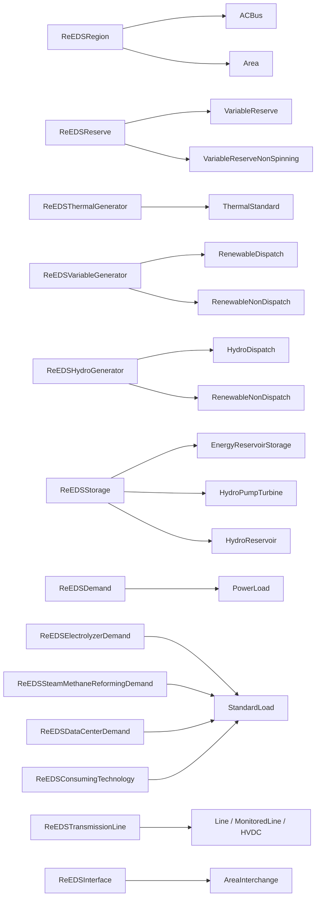

Parse the source model, translate its components, and export the target model.

[Translation source](https://github.com/NatLabRockies/R2X/blob/main/packages/r2x-reeds-to-sienna/src/r2x_reeds_to_sienna/translation.py) · [Configuration](https://github.com/NatLabRockies/R2X/blob/main/packages/r2x-reeds-to-sienna/src/r2x_reeds_to_sienna/plugin_config.py)

## Mapping Overview

ReEDS technologies are translated into Sienna component families. Several
ReEDS classes intentionally map to the same Sienna class, while demand and
storage classes use dedicated target types.



### Demand and Storage

The demand-specific classes (`ReEDSElectrolyzerDemand`,
`ReEDSSteamMethaneReformingDemand`, `ReEDSDataCenterDemand`, and
`ReEDSConsumingTechnology`) become `StandardLoad`. Their time series and
annual demand information are attached by the translation helpers.

For field-by-field mappings, see [ReEDS to Sienna property mappings](/R2X/reference/reeds-to-sienna-properties/).

## Setup

Use Python 3.11–3.13 and uv. From this repository checkout, replace the
editable package paths below with your local parser and exporter checkouts.
These commands update the workspace environment and lockfile:

```bash
uv sync &&
uv add --editable /path/to/r2x-reeds &&
uv add --editable /path/to/r2x-sienna
```

## Example script

Replace the model paths and years with your input data. A successful run writes
the target model and time-series files to the configured results directory.
`run()` executes the plugin lifecycle and raises an error if a hook fails.

```python
from pathlib import Path
from typing import cast

from r2x_reeds import ReEDSConfig, ReEDSParser
from r2x_reeds_to_sienna.plugin_config import ReEDSToSiennaConfig
from r2x_reeds_to_sienna.translation import reeds_to_sienna
from r2x_sienna.exporter import SiennaExporter
from r2x_sienna.plugin_config import SiennaConfig

from r2x_core import DataStore, PluginContext
from r2x_core.logger import setup_logging

setup_logging(verbosity=2)

case_name = "reeds_run_folder_name"
base_path = "/path/to/reeds/runs"
run_path = Path(base_path) / case_name

# ReEDS PARSER
solve_year = 2035
weather_year = 2012
scenario = "base"
reeds_config = ReEDSConfig(
    solve_year=solve_year,
    weather_year=weather_year,
    case_name=case_name,
    scenario=scenario,
    models=("r2x_reeds.models", "r2x_sienna.models"),
)

store = DataStore.from_plugin_config(reeds_config, path=run_path)
context = PluginContext(config=reeds_config, store=store)

parser = cast(ReEDSParser, ReEDSParser.from_context(context))
reeds_sys = parser.run()
reeds_sys = reeds_sys.system
sienna_sys = reeds_to_sienna(reeds_sys, ReEDSToSiennaConfig())

# Sienna Exporter
results_dir = Path(base_path) / f"{case_name}_results"
results_dir.mkdir(exist_ok=True)

exported_system = f"{case_name}.json"
output_file = results_dir / exported_system
sienna_config = SiennaConfig(
    model_year=solve_year,
    system_name=exported_system,
    output_path=str(output_file),
    system_base_power=100.0,
    scenario=scenario,
)

exporter_context = PluginContext(
    config=sienna_config,
    system=sienna_sys,
)
exporter = SiennaExporter.from_context(exporter_context)
exporter.run()
```
