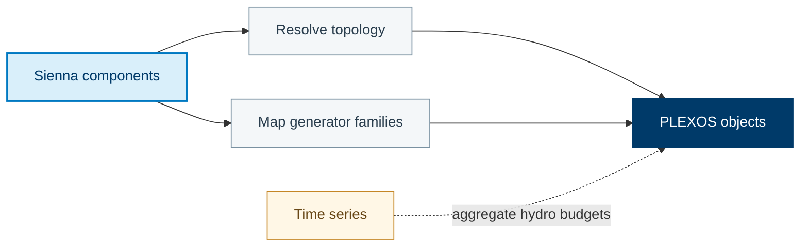

Parse the source model, translate its components, and export the target model.

[Translation source](https://github.com/NatLabRockies/R2X/blob/main/packages/r2x-sienna-to-plexos/src/r2x_sienna_to_plexos/translation.py) · [Configuration](https://github.com/NatLabRockies/R2X/blob/main/packages/r2x-sienna-to-plexos/src/r2x_sienna_to_plexos/plugin_config.py)

## Mapping Overview

PLEXOS does not distinguish all of the generator families represented by
Sienna. The reverse translation therefore collapses multiple Sienna generator
types into `PLEXOSGenerator`, with the exported `category` and memberships
preserving the information PLEXOS can represent.



### Generator Collapse

`ThermalStandard`, `ThermalMultiStart`, `HydroDispatch`,
`HydroEnergyReservoir`, `HydroTurbine`, `HydroPumpTurbine`,
`RenewableDispatch`, and `RenewableNonDispatch` all export as
`PLEXOSGenerator`. PLEXOS-specific category values and memberships are added
by the translation helpers after rule application.

For field-by-field mappings, see [Sienna to PLEXOS property mappings](/R2X/reference/sienna-to-plexos-properties/).

## Setup

Complete [installation](/R2X/getting-started/installation/) in a Python 3.11–3.13
virtual environment, then install the published translator and its parser/exporter
dependencies:

```bash
python -m pip install r2x-sienna-to-plexos
python -m pip check
```

Use compatible versions of the source and target packages. You do not need to
modify this repository's lockfile or add editable checkouts to run a translation.
For a runnable exercise without external model data, start with the
[Python translation tutorial](/R2X/tutorials/python-translation/).

<span id="example-script"></span>

## Run the translation

Start a fresh Python console for this workflow. Replace the model paths and years
with your input data before entering the session below. A successful run writes
the target model and time-series files to the configured results directory.
`run()` executes the plugin lifecycle and raises an error if a hook fails.

```pycon
>>> from pathlib import Path
>>> from typing import cast

>>> from r2x_plexos import PLEXOSConfig
>>> from r2x_plexos.exporter import PLEXOSExporter
>>> from r2x_sienna.parser import SiennaParser
>>> from r2x_sienna.plugin_config import SiennaConfig
>>> from r2x_sienna_to_plexos.plugin_config import SiennaToPlexosConfig
>>> from r2x_sienna_to_plexos.translation import sienna_to_plexos

>>> from r2x_core import DataStore, PluginContext
>>> from r2x_core.logger import setup_logging

>>> setup_logging(verbosity=1)

>>> base_path = Path("/path/to/sienna-to-plexos")
>>> sys_name = "EI_PCM_2023_2012"
>>> sys_folder = base_path / sys_name

>>> # Sienna PARSER
>>> model_year = 2023
>>> weather_year = 2012
>>> json_path = sys_folder / f"{sys_name}.json"
>>> sienna_config = SiennaConfig(
...     json_path=str(json_path),
...     model_year=model_year,
...     system_name=sys_name,
...     skip_validation=True,
...     models=("r2x_sienna.models", "r2x_plexos.models", "r2x_sienna_to_plexos.getters"),
... )
>>> store = DataStore.from_data_files([], path=json_path.parent)
>>> context = PluginContext(config=sienna_config, store=store, skip_validation=True)
>>> parser = cast(SiennaParser, SiennaParser.from_context(context))
>>> sienna_sys = parser.run()
>>> sienna_sys = sienna_sys.system

>>> # Define Time Series Storage
>>> plexos_sys = sienna_to_plexos(sienna_sys, SiennaToPlexosConfig())
>>> assert len(list(plexos_sys.iter_all_components())) > 0

>>> # PLEXOS Exporter
>>> results_dir = base_path / f"{sys_name}_results"
>>> results_dir.mkdir(exist_ok=True)
>>> plexos_config = PLEXOSConfig(model_name=sys_name, timeseries_dir=str(results_dir), horizon_year=model_year)
>>> exporter_context = PluginContext(config=plexos_config, system=plexos_sys)

>>> exporter = PLEXOSExporter.from_context(exporter_context)
>>> exporter.output_path = results_dir
>>> exporter.solve_year = model_year
>>> exporter.weather_year = weather_year

>>> export_result = exporter.run()
>>> assert any(path.stat().st_size > 0 for path in Path(results_dir).glob("*.xml"))
```

To export hydro budgets as monthly profiles instead of the default weekly aggregation,
set `SiennaToPlexosConfig(hydro_budget_ts="monthly")` in the call to
`sienna_to_plexos`.
