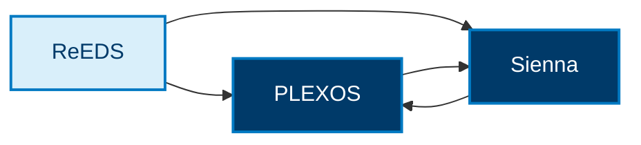

This repository contains the interoperability layer in the
[r2x-cli](https://github.com/NatLabRockies/r2x-cli) ecosystem. It connects
model-specific parsers and exporters through shared
[`r2x-core`](https://github.com/NatLabRockies/r2x-core) systems, rules, plugins,
data stores, and units.

## Start here

- [Prerequisites](/R2X/getting-started/prerequisites/) helps you choose an environment and input data.
- [Installation](/R2X/getting-started/installation/) installs published packages and verifies plugin discovery.
- [Translation plugins](/R2X/getting-started/plugins/) explains all four registered transforms.
- [Translate in Python](/R2X/tutorials/python-translation/) builds and checks a small source graph.
- [First CLI pipeline](/R2X/tutorials/getting-started/) runs and inspects a small public model.
- [Translation workflows](/R2X/how-to/) contains task-focused,
  end-to-end interoperability examples.
- [Architecture](/R2X/explanation/architecture/) explains the parser, interoperability, and
  exporter boundaries.
- [Development](/R2X/how-to/development/) covers repository checks and changes to
  interoperability packages.

## Translation plugins

ReEDS translates to either PLEXOS or Sienna. PLEXOS and Sienna also translate to
each other through separate plugins. The arrows show supported directions;
there is no translation back to ReEDS.

Follow each package's PyPI link for its latest release and registry information.
Match parser and exporter dependencies before upgrading.

| Package | Release | Direction |
| --- | --- | --- |
| [`r2x-reeds-to-plexos`](https://github.com/NatLabRockies/R2X/tree/main/packages/r2x-reeds-to-plexos) | [Latest release](https://pypi.org/project/r2x-reeds-to-plexos/) | [ReEDS → PLEXOS](/R2X/how-to/reeds-to-plexos/) · [properties](/R2X/reference/reeds-to-plexos-properties/) |
| [`r2x-reeds-to-sienna`](https://github.com/NatLabRockies/R2X/tree/main/packages/r2x-reeds-to-sienna) | [Latest release](https://pypi.org/project/r2x-reeds-to-sienna/) | [ReEDS → Sienna](/R2X/how-to/reeds-to-sienna/) · [properties](/R2X/reference/reeds-to-sienna-properties/) |
| [`r2x-plexos-to-sienna`](https://github.com/NatLabRockies/R2X/tree/main/packages/r2x-plexos-to-sienna) | [Latest release](https://pypi.org/project/r2x-plexos-to-sienna/) | [PLEXOS → Sienna](/R2X/how-to/plexos-to-sienna/) · [properties](/R2X/reference/plexos-to-sienna-properties/) |
| [`r2x-sienna-to-plexos`](https://github.com/NatLabRockies/R2X/tree/main/packages/r2x-sienna-to-plexos) | [Latest release](https://pypi.org/project/r2x-sienna-to-plexos/) | [Sienna → PLEXOS](/R2X/how-to/sienna-to-plexos/) · [properties](/R2X/reference/sienna-to-plexos-properties/) |

## Compatibility

Use parser and exporter versions compatible with the translation package. Each
workflow lists its required packages. Historical compatibility information is
available in the release archives selected from the version menu.

See [architecture](/R2X/explanation/architecture/) for ecosystem boundaries and
[open issues](https://github.com/NatLabRockies/R2X/issues) for planned work.
