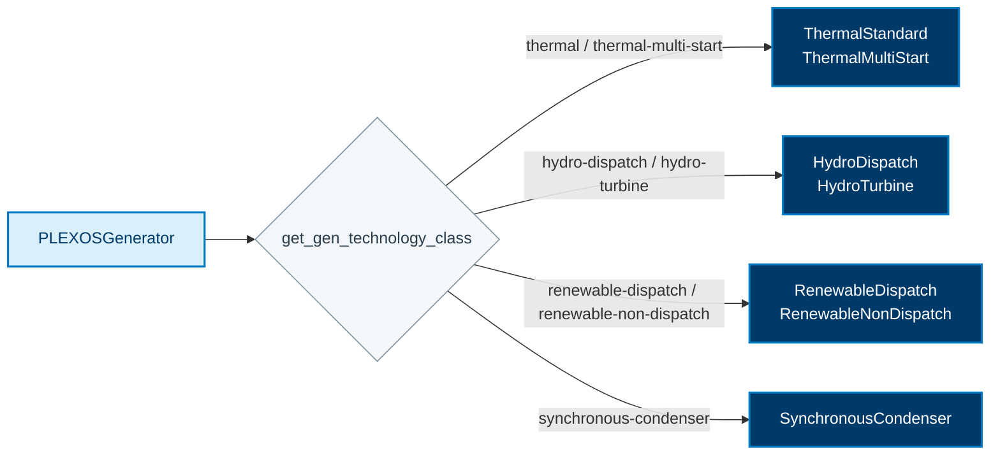
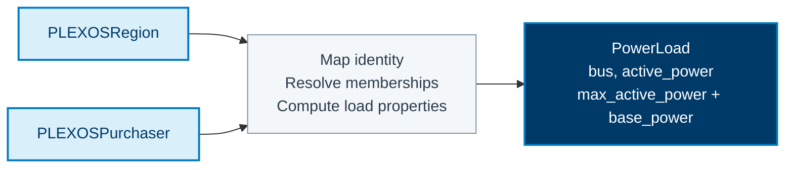

This page documents the property-level mappings used by
`r2x-plexos-to-sienna`. The class mappings are summarized in
[PLEXOS to Sienna](/R2X/how-to/plexos-to-sienna/). This page explains how fields are
copied or computed after the target class is selected.

The authoritative source is the
[`rules.json`](https://github.com/NatLabRockies/R2X/blob/main/packages/r2x-plexos-to-sienna/src/r2x_plexos_to_sienna/config/rules.json)
file. In the tables below, **field map** means a direct source-to-target field
copy and **getter** means a computed value supplied by a translation helper.

## Component conversion

PLEXOS generator categories are resolved by `get_gen_technology_class`; matching
rules select the Sienna class. The selected rule combines direct identity fields,
defaults and computed properties. The groups below summarize the target families,
not an unconditional expansion of one generator into every displayed class.

### Generator family selection

Within each grouped node, the class matches the corresponding classification
value in the same order. Generator limits, costs, bus references and services
come from getters; they are not all direct field copies.

### Loads and bus references

`PLEXOSRegion` and `PLEXOSPurchaser` have separate rules that produce `PowerLoad`.
Their getters resolve target bus references through source memberships and
compute load properties. Node load time series are attached to target loads
under the `active_power` name by the translation helpers.

## Common Fields

| Source property | Target property | Mapping |
| --- | --- | --- |
| `name` | `name` | field map |
| `uuid` | `uuid` | field map |
| `category` | `category` | field map or target default |
| PLEXOS `availability`/`units` | `available` or `units` | getter or field map |

## Network and Loads

| Source class | Target class | Direct fields | Computed properties |
| --- | --- | --- | --- |
| `PLEXOSZone` | `LoadZone` | `name`, `category`, `uuid` | `peak_active_power`, `peak_reactive_power` |
| `PLEXOSNode` | `ACBus` | `name`, `uuid`, `category` | `number`, `base_voltage`, `magnitude`, `bustype`, `area`, `load_zone`, `angle`, `ext` |
| `PLEXOSRegion` | `PowerLoad` | `name`, `uuid`, `category` | `bus`, `active_power`, `reactive_power`, `max_active_power`, `max_reactive_power`, `base_power` |
| `PLEXOSPurchaser` | `PowerLoad` | `name`, `uuid`, `category` | `bus`, `active_power`, `available`, `max_active_power`, `reactive_power`, `max_reactive_power`, `base_power` |
| `PLEXOSRegion` | `Area` | `name`, `category` | `load_response`, `peak_active_power`, `peak_reactive_power` |

Node-to-region and purchaser-to-node memberships are used by the getters to
resolve the target bus. A node's `load` time series is renamed to the target
load's `active_power` time series.

## Generator Properties

| Selected Sienna class | Direct fields | Computed properties |
| --- | --- | --- |
| `ThermalStandard` | `name`, `uuid`, `category`, `rating` | `active_power`, `active_power_limits`, `available`, `base_power`, `bus`, `fuel`, `must_run`, `operation_cost`, `prime_mover_type`, `ramp_limits`, `reactive_power`, `reactive_power_limits`, `services`, `status`, `time_at_status`, `time_limits` |
| `ThermalMultiStart` | `name`, `uuid`, `category`, `rating` | Thermal properties plus `start_types` |
| `HydroDispatch` | `name`, `uuid`, `category`, `rating` | `active_power`, `active_power_limits`, `base_power`, `bus`, `operation_cost`, `prime_mover_type`, `ramp_limits`, `reactive_power`, `reactive_power_limits`, `services`, `status`, `time_at_status`, `time_limits` |
| `HydroTurbine` | `name`, `uuid`, `category`, `rating` | `active_power`, `active_power_limits`, `base_power`, `bus`, `operation_cost`, `prime_mover_type`, `ramp_limits`, `reactive_power`, `reactive_power_limits`, `services`, `time_limits` |
| `RenewableDispatch` | `name`, `uuid`, `category`, `rating` | `active_power`, `base_power`, `bus`, `operation_cost`, `power_factor`, `prime_mover_type`, `reactive_power`, `reactive_power_limits`, `services` |
| `RenewableNonDispatch` | `name`, `uuid`, `category`, `rating` | `active_power`, `base_power`, `bus`, `power_factor`, `prime_mover_type`, `reactive_power`, `services` |
| `SynchronousCondenser` | `name`, `uuid`, `category`, `rating` | `active_power_losses`, `base_power`, `bus`, `reactive_power`, `reactive_power_limits`, `services` |

Generator `category` selects the row family; see the category diagram and
family details in [PLEXOS to Sienna](/R2X/how-to/plexos-to-sienna/).

## Other Components

| Source class | Target class | Property highlights |
| --- | --- | --- |
| `PLEXOSReserve` | `VariableReserve` | `time_frame`, `requirement`, `reserve_type`, `direction`, `sustained_time`, `participation`, `deployment` fractions |
| `PLEXOSLine` | `Line` / `MonitoredLine` / `TwoTerminalGenericHVDCLine` | `active_power_flow`, `ratings`, `resistance`, `reactance`, `arcs`, `flow_limits`, `losses` |
| `PLEXOSTransformer` | `Transformer2W` / `TapTransformer` / `PhaseShiftingTransformer` | `resistance`, `reactance`, `rating`, `tap`, `control_objective`, `shunt`, `winding_group` |
| `PLEXOSInterface` | `TransmissionInterface` | `flow_limits`, `availability`, `direction` mapping |
| `PLEXOSBattery` | `EnergyReservoirStorage` | `power_limits`, `efficiency`, `SOC`, `storage` capacity/target, `technology`, `bus`, `services` |
| `PLEXOSStorage` | `HydroReservoir` | `initial_level`, `bus`, `operation_cost`, `services` |

Target defaults such as `category="power-load"`, `category="node"`, and
`category="line"` are applied by the rules when the source does not provide a
compatible value. Category filters distinguish monitored lines, HVDC lines,
and transformer variants.
