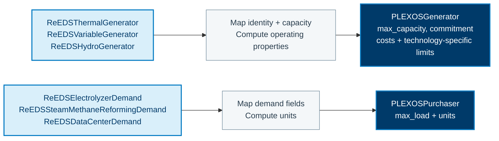
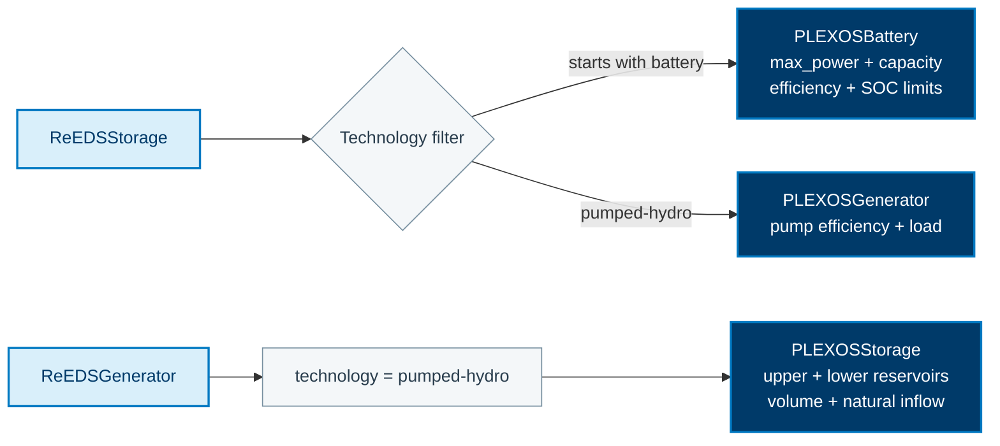

See the [ReEDS translation comparison](/R2X/reference/reeds-translation-reference/)
for side-by-side component mappings, time-series treatment, and modeling limitations.

This page documents property-level mappings for `r2x-reeds-to-plexos`. The
class-level flow is shown in [ReEDS to PLEXOS](/R2X/how-to/reeds-to-plexos/). The
[authoritative rules](https://github.com/NatLabRockies/R2X/blob/main/packages/r2x-reeds-to-plexos/src/r2x_reeds_to_plexos/config/rules.json)
contain the complete field maps, getters, defaults, and filters.

## Component conversion

These diagrams summarize selected rule families, not a one-to-one copy of every
field. Blue source nodes feed either a conversion step or an explicitly filtered
branch; dark nodes show the target classes and representative properties.
The tables below retain the full property reference.

### Generation and flexible demand

Thermal, variable and hydro generators converge on `PLEXOSGenerator`. Their
identity and capacity fields are mapped, while technology-specific getters
compute operating properties. Consuming technologies use that generator route
only when their technology is not `electrolyzer`, `data-center`, `smr` or `smr_ccs`.
Electrolyzer, steam-methane-reforming and data-center demand classes instead
become purchasers.

### Storage selection

`ReEDSStorage` follows the battery branch only when its technology starts with
`battery` (case-insensitive); `pumped-hydro` follows the generator branch.
The reservoir rules are separate: they read `ReEDSGenerator` with technology
`pumped-hydro` and create the upper and lower `PLEXOSStorage` objects. Do not
interpret the storage branches as an unconditional conversion to both targets.

## Generator and Demand Properties

| Source class | Target class | Direct fields | Computed properties |
| --- | --- | --- | --- |
| `ReEDSThermalGenerator` | `PLEXOSGenerator` | `name`, `uuid`, `category`, `max_capacity`, `fom_charge`, `vom_charge`, `fuel_price`, `heat_rate`, `ext` | `commitment`, outage/maintenance rates, `ramp_limits`, `minimum_levels`, `start_cost`, `units` |
| `ReEDSVariableGenerator` | `PLEXOSGenerator` | `name`, `uuid`, `category`, `max_capacity`, `fom_charge`, `vom_charge`, `ext` | `commitment`, outage/maintenance rates, `rating`, `load_subtracter`, `start_cost`, `units` |
| `ReEDSHydroGenerator` | `PLEXOSGenerator` | `name`, `uuid`, `category`, `max_capacity`, `fom_charge`, `vom_charge`, `ext` | `commitment`, `energy/day`, outage/maintenance rates, `ramps`, `minimum_levels`, `start_cost`, `units` |
| `ReEDSConsumingTechnology` | `PLEXOSGenerator` | `name`, `uuid`, `category`, `max_capacity`, `fom_charge`, `vom_charge`, `fuel_price`, `heat_rate`, `ext` | `commitment`, outage/maintenance rates, `ramps`, `minimum_levels`, `start_cost`, `units` |
| `ReEDSElectrolyzerDemand` | `PLEXOSPurchaser` | `name`, `category`, `max_load`, `ext` | `units` |
| `ReEDSSteamMethaneReformingDemand` | `PLEXOSPurchaser` | `name`, `category`, `max_load`, `ext` | `units` |
| `ReEDSDataCenterDemand` | `PLEXOSPurchaser` | `name`, `category`, `max_load`, `ext` | `units` |

All generator families use `PLEXOSGenerator`; the source technology category is
preserved so PLEXOS can distinguish the exported technology where its model
allows it. Purchaser profiles are attached separately by the time-series
helpers.

## Storage and Hydro Properties

| Source class | Target class | Direct fields | Computed properties |
| --- | --- | --- | --- |
| `ReEDSStorage` | `PLEXOSBattery` | `name`, `category`, `max_power`, `ext` | build/capital cost, `capacity`, charge/discharge efficiency, `duration`, `SOC` limits, outage/maintenance rates, `units`, variable cost |
| `ReEDSStorage` | `PLEXOSGenerator` | `name`, `category`, `max_capacity`, `ext` | `commitment`, outage/maintenance rates, `minimum_level`, pump efficiency/load, `units`, variable cost |
| `ReEDSGenerator` | `PLEXOSGenerator` | `name`, `uuid`, `category`, `max_capacity`, `ext`, `fuel_price`, `heat_rate`, `vom_charge` | `commitment`, outage/maintenance rates, `ramps`, `minimum_levels`, pump efficiency/load, `start_cost`, `units` |
| `ReEDSGenerator` | `PLEXOSStorage` | `name`, `category`, `ext` | `initial_volume`, `maximum_volume`, `natural_inflow`, `units` |

## Topology and Other Components

| Source class | Target class | Property highlights |
| --- | --- | --- |
| `ReEDSRegion` | `PLEXOSRegion` | `name`/`category`/`ext`, `load`, `units` |
| `ReEDSRegion` | `PLEXOSZone` | `name`/`category`, `units` |
| `ReEDSRegion` | `PLEXOSNode` | `name`/`category`/`ext`, `load_participation_factor`, `units` |
| `ReEDSTransmissionLine` | `PLEXOSLine` | `name`/`category`, `min`/`max_flow`, `losses`, `wheeling_charges`, `units` |
| `ReEDSReserve` | `PLEXOSReserve` | `name`/`category`, `duration`, `minimum_provision`, `timeframe`, `type`, `VORS`, `ext` |
| `ReEDSInterface` | `PLEXOSInterface` | `name`, `min`/`max_flow`, `units`, `ext` |

Membership rules then connect the generated PLEXOS objects to the target
network topology. The property rules select the applicable output with filters
for hydro/storage variants and other technology-specific cases.
