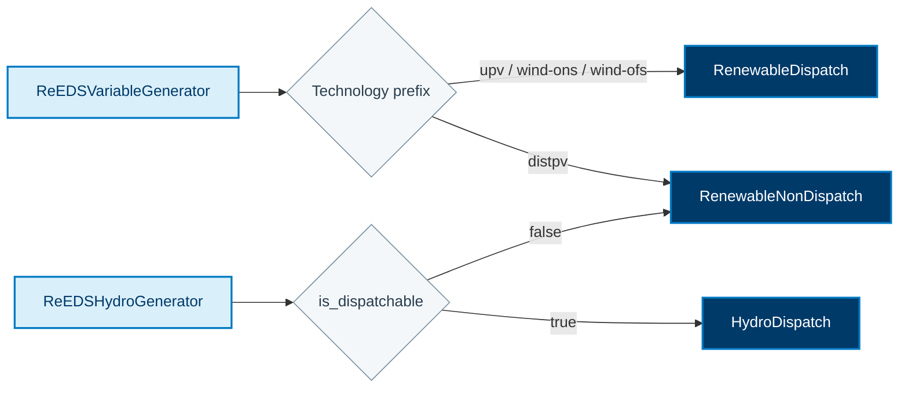
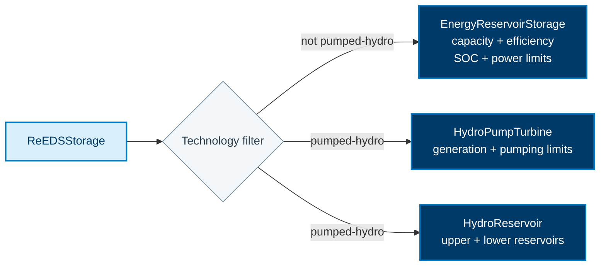

See the [ReEDS translation comparison](/R2X/reference/reeds-translation-reference/)
for side-by-side component mappings, time-series treatment, and modeling limitations.

This page documents property-level mappings for `r2x-reeds-to-sienna`. The
class-level flow is shown in [ReEDS to Sienna](/R2X/how-to/reeds-to-sienna/). The
[authoritative rules](https://github.com/NatLabRockies/R2X/blob/main/packages/r2x-reeds-to-sienna/src/r2x_reeds_to_sienna/config/rules.json)
combine direct field maps, computed getters, defaults, and filters.

## Component conversion

Sienna has distinct component classes for operating behavior. Rule filters select
those classes before field maps, defaults and getters populate their properties.
These diagrams highlight renewable and storage selection; the tables below also
cover thermal generation, demand, topology and reserves.

### Renewable and hydro selection

For `ReEDSVariableGenerator`, the technology prefixes `upv`, `wind-ons` and
`wind-ofs` select `RenewableDispatch`; `distpv` selects `RenewableNonDispatch`
(case-insensitive). For `ReEDSHydroGenerator`, `is_dispatchable` selects
`HydroDispatch` or `RenewableNonDispatch`. The diagram groups the two paths to the
same target without treating their property getters as identical.

The matching rule computes bus references, power limits, ratings and operating
properties where applicable. Time-series normalization and attachment happen
after rule application; a profile is not simply a copied scalar field.

### Storage selection

Technology `pumped-hydro` produces a `HydroPumpTurbine` plus two `HydroReservoir`
objects. Other storage technologies select `EnergyReservoirStorage`. The
technology comparisons are case-insensitive.

## Network, Reserves, and Loads

| Source class | Target class | Direct fields | Computed properties |
| --- | --- | --- | --- |
| `ReEDSRegion` | `ACBus` | `name`, `uuid` | `angle`, `area`, `base_voltage`, `bustype`, `magnitude`, `number` |
| `ReEDSRegion` | `Area` | `name`, `uuid` | `category`, `peak_active_power` |
| `ReEDSReserve` | `VariableReserve` | `name`, `uuid` | `time_frame`, `requirement`, `reserve_type`, `direction`, `sustained_time`, `participation`/`deployment` fractions |
| `ReEDSReserve` | `VariableReserveNonSpinning` | `name`, `uuid` | `time_frame`, `requirement`, `sustained_time`, `participation`/`deployment` fractions |
| `ReEDSDemand` | `PowerLoad` | `name`, `uuid`, `category` | `demand` and `bus` properties from getters |

## Generator Properties

| Source class | Target class | Direct fields | Computed properties |
| --- | --- | --- | --- |
| `ReEDSThermalGenerator` | `ThermalStandard` | `name`, `uuid`, `category` | `active_power`, limits, `base_power`, `bus`, `fuel`, `must_run`, `operation_cost`, `prime_mover`, `ramps`, `reactive_power`, `services`, `status`, `time_limits` |
| `ReEDSVariableGenerator` | `RenewableDispatch` | `name`, `uuid`, `category` | `active_power`, `base_power`, `bus`, `operation_cost`, `prime_mover`, `rating`, `reactive_power`, `services` |
| `ReEDSVariableGenerator` | `RenewableNonDispatch` | `name`, `uuid`, `category` | same renewable fields with non-dispatch behavior |
| `ReEDSHydroGenerator` | `HydroDispatch` | `name`, `uuid`, `category` | `active_power` limits, `bus`, `operation_cost`, `prime_mover`, `ramps`, `reactive_power`, `services`, `time_limits` |
| `ReEDSHydroGenerator` | `RenewableNonDispatch` | `name`, `uuid`, `category` | renewable non-dispatch fields for the filtered hydro case |

The same ReEDS source class can produce different Sienna target classes when a
rule filter matches a category or other source property.

## Storage and Flexible Demand

| Source class | Target class | Property highlights |
| --- | --- | --- |
| `ReEDSStorage` | `EnergyReservoirStorage` | `power`, `efficiency`, `SOC`, `capacity`, `storage_targets`, `technology`, `bus`, `services` |
| `ReEDSStorage` | `HydroPumpTurbine` | `generation` and `pumping` limits, `efficiency`, `rating`, `bus`, `operation_cost`, `services` |
| `ReEDSElectrolyzerDemand` | `StandardLoad` | `name`/`category` and `demand_profile` properties |
| `ReEDSSteamMethaneReformingDemand` | `StandardLoad` | `name`/`category` and `demand_profile` properties |
| `ReEDSDataCenterDemand` | `StandardLoad` | `name`/`category` and `demand_profile` properties |
| `ReEDSConsumingTechnology` | `StandardLoad` | `name`/`category` and `demand_profile` properties |

## Network and Interchange

| Source class | Target class | Property highlights |
| --- | --- | --- |
| `ReEDSTransmissionLine` | `Line` / `MonitoredLine` / `TwoTerminalGenericHVDCLine` | `flow_limits`, `loss_increment`, `wheeling_charges`, `units` |
| `ReEDSInterface` | `AreaInterchange` | `name`, `units`, `minimum`/`maximum_flow` |

Time series are attached after rule application. Generator and demand profiles
therefore appear as target component properties plus target-system time-series
records rather than as scalar fields alone.
