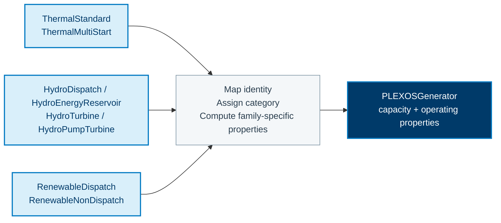
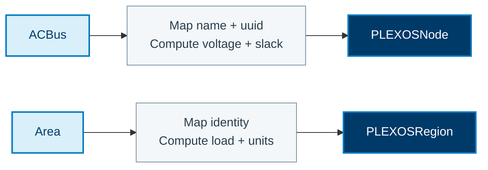

This page documents property-level mappings for `r2x-sienna-to-plexos`. The
class-level flow is shown in [Sienna to PLEXOS](/R2X/how-to/sienna-to-plexos/). The
[authoritative rules](https://github.com/NatLabRockies/R2X/blob/main/packages/r2x-sienna-to-plexos/src/r2x_sienna_to_plexos/config/rules.json)
contain the complete field maps, getters, defaults, and filters.

## Component conversion

Sienna's operating classes converge on a smaller set of PLEXOS classes.
The diagrams summarize generator convergence and two network mappings. Each
source family retains its own getters and defaults; sharing a target class does
not make all property mappings identical.

### Generator family convergence

Thermal, hydro and renewable classes listed in the table create
`PLEXOSGenerator`. Identity fields are mapped, while source-family getters
compute operating properties and defaults assign the target category.

### Network properties and relationships

`ACBus` becomes a `PLEXOSNode`, with voltage and slack-related properties computed
from the bus. `Area` becomes a `PLEXOSRegion`, with load computed by getters.
After rule application, membership helpers connect these objects into the PLEXOS
network; those relationships are not represented by scalar field maps alone.

## Network Properties

| Source class | Target class | Direct fields | Computed properties |
| --- | --- | --- | --- |
| `ACBus` | `PLEXOSNode` | `name`, `uuid` | `category`, `slack` flag, `load_participation`, `units`, `voltage` |
| `Area` | `PLEXOSRegion` | `name`, `uuid`, `category` | `ext`, `load`, `units` |
| `LoadZone` | `PLEXOSZone` | `name`, `uuid`, `category` | `units` |
| `Line` / `MonitoredLine` | `PLEXOSLine` | `name`, `category`, `resistance`/`reactance`, `uuid` | `losses`, `flow_limits`, `wheeling_charges`, `units` |
| HVDC line variants | `PLEXOSLine` | `name`, `category`, `resistance`/`reactance` where available, `uuid` | `losses`, `flow_limits`, `units` |
| Transformer variants | `PLEXOSTransformer` | `name`/`category`, `resistance`/`reactance`, `uuid` | `rating`, `susceptance`, `units` |

Three-winding transformer rules repeat the source class with different winding
membership targets. The exporter helpers add the required PLEXOS memberships
for nodes, lines, and transformers after rule application.

## Generator Properties

All of the following Sienna source classes export as `PLEXOSGenerator`:

| Source class | Direct fields | Computed properties |
| --- | --- | --- |
| `ThermalStandard` | `name`, `uuid` | `category`, `capacity`, `rating`, `fuel_price`, heat-rate fields, `commitment`, outage/maintenance rates, `ramps`, `minimum_levels`, `start`/`shutdown_costs`, `units` |
| `ThermalMultiStart` | `name`, `uuid` | thermal properties plus multi-start/`commitment` fields |
| `HydroDispatch` | `name`, `uuid` | `category`, `capacity`, `energy/day`, `ramps`, outage/maintenance rates, pump/load fields where applicable |
| `HydroEnergyReservoir` | `name`, `uuid` | hydro generator `capacity`, `energy`, `ramps`, and operating fields |
| `HydroTurbine` | `name`, `uuid` | `category`, `capacity`, `ramps`, pump/load fields, operating costs |
| `HydroPumpTurbine` | `name`, `uuid` | `category`, `capacity`, `ramps`, pump efficiency/load, operating costs |
| `RenewableDispatch` | `name`, `uuid` | `category`, `commitment`, `load_subtracter`, `capacity`, `rating`, `units` |
| `RenewableNonDispatch` | `name`, `uuid` | `category`, `commitment`, `load_subtracter`, `capacity`, `rating`, `units` |

The target PLEXOS category is assigned by the rule defaults and source family.
This is the reverse of PLEXOS-to-Sienna category selection: Sienna's richer
technology classes collapse into the single PLEXOS generator model.

## Storage, Reserves, and Interfaces

| Source class | Target class | Property highlights |
| --- | --- | --- |
| `HydroReservoir` | `PLEXOSStorage` | `name`, `initial`/`max_volume`, `natural_inflow`, `ext`, `uuid` |
| `EnergyReservoirStorage` | `PLEXOSBattery` | `name`, `capacity`, `SOC`, charge/discharge efficiency, `max_power`, outage/maintenance rates, `cycles` |
| `VariableReserve` | `PLEXOSReserve` | `name`/`category`, `duration`, `minimum_provision`, `timeframe`, `type`, `VORS`, `ext` |
| `TransmissionInterface` | `PLEXOSInterface` | `name`/`category`, `minimum`/`maximum_flow`, `ext`, `units` |

Time-series and membership helpers are part of the property translation
workflow. They attach generator profiles and create the PLEXOS relationships
that cannot be represented by scalar field maps alone.
